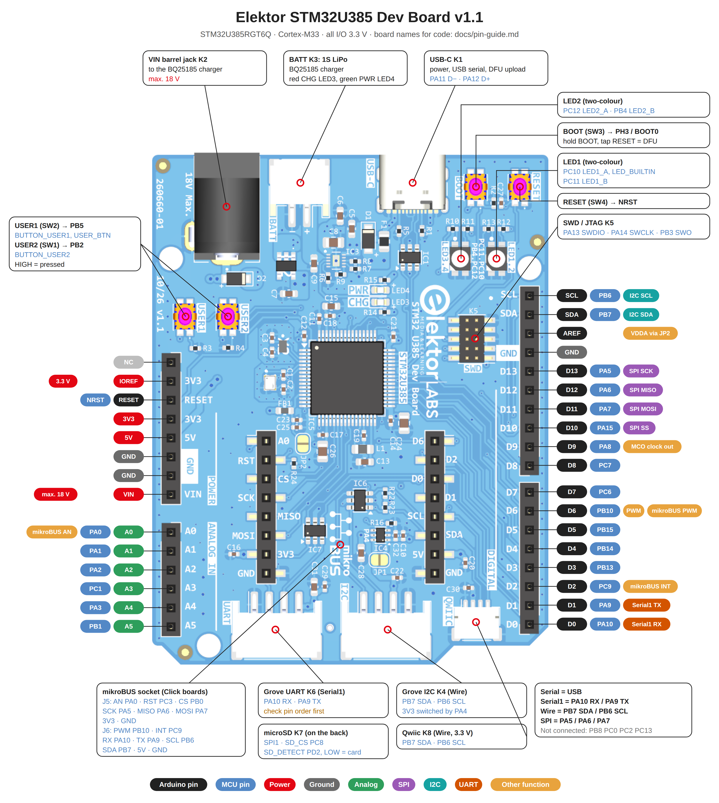

# Elektor STM32U385 Dev Board: Arduino support

Arduino IDE support for the Elektor STM32U385 development board (schematic
260660-002, Rev 1.0), built on the official
[STM32duino](https://github.com/stm32duino/Arduino_Core_STM32) core.

What you get:

- **Board package (`elektor:stm32:u385board`):**
  - Every pin is named after the board, so you don't need the schematic:
    `LED1_A`, `BUTTON_USER1`, `SD_CS`, `GROVE_I2C_POWER`, `MIKROBUS_CS`, ...
  - `Serial` is the USB serial port; `Serial1`, `Wire` and `SPI` sit on the
    right header pins.
  - Uploads go over USB: BOOT + RESET, then *Upload*. An optional
    auto-reset method needs no buttons at all.
- **Elektor STM32U385 Dev Board library** (`U385Board.h`): LEDs, debounced
  buttons, clock switching, MCO output, temperature, VDDA, unique ID, reset
  cause and SMPS/LDO selection.
- **Nine examples:** LED cycle, LEDs with buttons, USB serial, board info,
  clock switching, low-power modes, Grove I2C scanner, microSD card and a
  mikroBUS Click tester.

| | |
|---|---|
| MCU | STM32U385RGT6Q: Cortex-M33, 96 MHz, 1 MB flash, 256 KB SRAM, SMPS package |
| USB | USB-C, full speed (CDC serial and ROM DFU bootloader) |
| Clocks | MSIS 96 MHz (default), HSI48 + CRS for USB, 16 MHz HSE crystal, 32.768 kHz LSE crystal |
| On board | 2 × two-colour LEDs (4 channels), User1/User2/Boot/Reset buttons, microSD, Grove I2C (switched), Grove/UART header, Qwiic, mikroBUS, Arduino Uno headers, LiPo charger |



## Documentation

| Document | Read it when |
|---|---|
| This README | Overview, pin names, library overview, examples, known issues |
| [Windows install](docs/windows-install.md) | Installing on Windows, in five steps |
| [Install guide](src/README.md) | Installing on Linux, macOS or Windows; arduino-cli, git links, Tools menu |
| [Pinout drawing](docs/pinout.png) ([SVG](docs/pinout.svg)) | Quick look at every header pin, connector, LED and button |
| [Pin guide](docs/pin-guide.md) | Wiring something up: every header pin, connector, on-board part and board name, plus the power section |
| [Board top](docs/board-top.png) / [bottom](docs/board-bottom.png) | Finding a part or connector on the PCB |
| [Schematic](docs/schematic-260660-002.png) | You need to trace a signal or check a component value |
| [How uploading works](docs/uploading.md) | Upload fails, the board stays in DFU, or you want to know what the button-free upload does |
| [Board and software overview](docs/board-and-software-overview.md) | Everything in one document: v1.1 changes, board package, library, all examples with code, upload internals, bring-up (source for the article) |
| [Problems and solutions](docs/problems-and-solutions.md) | Background: every hurdle during bring-up and how it was solved, including the drawbacks of button-free upload |
| [`U385Board.h`](src/Arduino/libraries/Elektor_STM32U385_DevBoard/src/U385Board.h) | Library reference: every function, with a comment explaining it |
| [`variant_U385_BOARD.h`](src/Arduino15/packages/elektor/hardware/stm32/1.0.0/variants/U385_BOARD/variant_U385_BOARD.h) | All pin numbers and board names as the compiler sees them |
| [Examples](src/Arduino/libraries/Elektor_STM32U385_DevBoard/examples) | Working code for every part of the board (also under *File → Examples → Elektor STM32U385 Dev Board*) |

## Repository layout

```
hardware/                          KiCad design files (board v1.1)
src/                               software; install guide in src/README.md
  Arduino15/                       paste "packages" into your Arduino15 folder
    packages/elektor/hardware/stm32/1.0.0/   the board package
      boards.txt, platform.txt     board definition, upload tool
      variants/U385_BOARD/         pin map, clock setup, button-free upload hook
      tools/dfu-upload.sh          upload script (dfu-util)
      tools/win/                   Windows: put dfu-util.exe here
      tools/linux/99-elektor-u385.rules   udev rule for Linux
  Arduino/                         paste "libraries" into your sketchbook
    libraries/Elektor_STM32U385_DevBoard/    the Arduino library
      src/U385Board.h, .cpp
      examples/                    00_LedCycle ... 08_MikroBus
docs/                              guides, pinout, schematic, board renders
  pin-guide.md                     every pin, connector and board name
  windows-install.md               Windows install in five steps
  uploading.md                     how the button-free upload works, recovery
  problems-and-solutions.md        hurdles during bring-up and how they were solved
  board-and-software-overview.md   everything in one document, with code
  schematic-260660-002.png         schematic
  pinout.png, pinout.svg           pinout drawing (made by docs/make_pinout.py)
  board-top.png, -bottom.png       board renders
```

## Getting started

1. Install **STM32 MCU based boards** 3.1.0 or newer from the Boards Manager.
2. Copy two folders from `src` (each merges with the folder already there):

   | Copy this | Windows | Linux | macOS |
   |---|---|---|---|
   | `src/Arduino15/packages` | `%LOCALAPPDATA%\Arduino15` | `~/.arduino15` | `~/Library/Arduino15` |
   | `src/Arduino/libraries` | `Documents\Arduino` | `~/Arduino` | `~/Documents/Arduino` |

3. Install dfu-util and the USB driver (Windows) or udev rule (Linux).
4. Put the board in DFU mode once (hold BOOT, press RESET) and upload
   *File → Examples → Elektor STM32U385 Dev Board → 00_LedCycle*.

Step by step: [Windows install](docs/windows-install.md) ·
[all systems, plus arduino-cli and git](src/README.md).

## Using the board

### Pin names

Use the board names; the STM32 names (`PA5`) and Arduino numbers (`13`) also
work. [docs/pin-guide.md](docs/pin-guide.md) has the full table with
connectors and schematic references.

The Arduino Uno headers are numbered as on any Uno, and each number is
mapped to the STM32 pin wired to that header position. These three lines
all drive the same pin, the D13 header pin (PA5):

```cpp
digitalWrite(13, HIGH);     // Arduino number
digitalWrite(D13, HIGH);    // Arduino name
digitalWrite(PA5, HIGH);    // STM32 name
```

| Header | STM32 | | Header | STM32 | | Header | STM32 |
|---|---|---|---|---|---|---|---|
| D0 | PA10 | | D6 | PB10 | | D12 | PA6 |
| D1 | PA9 | | D7 | PC6 | | D13 | PA5 |
| D2 | PC9 | | D8 | PC7 | | D14 | PB7 |
| D3 | PB13 | | D9 | PA8 | | D15 | PB6 |
| D4 | PB14 | | D10 | PA15 | | A0 / A1 / A2 | PA0 / PA1 / PA2 |
| D5 | PB15 | | D11 | PA7 | | A3 / A4 / A5 | PC1 / PA3 / PB1 |

The mapping is in
[`variant_U385_BOARD.h`](src/Arduino15/packages/elektor/hardware/stm32/1.0.0/variants/U385_BOARD/variant_U385_BOARD.h)
and was verified for every header pin with compile-time checks
(`static_assert(D13 == PA5)`, `static_assert(A3 == PC1)`, ...). The same pairs are printed on the pinout drawing.

| Name | Pin | What |
|---|---|---|
| `LED1_A` (`LED_BUILTIN`), `LED1_B` | PC10, PC11 | LED1, active high |
| `LED2_A`, `LED2_B` | PC12, PB4 | LED2, active high |
| `BUTTON_USER1` (`USER_BTN`) | PB5 | SW2 "User1", HIGH when pressed |
| `BUTTON_USER2` | PB2 | SW1 "User2", HIGH when pressed |
| `GROVE_I2C_POWER` | PA4 | HIGH turns on 3V3 at the Grove I2C socket K4 |
| `SD_CS`, `SD_DETECT` | PC8, PD2 | microSD over SPI; detect LOW = card in |
| `MIKROBUS_AN/RST/CS/PWM/INT` | PA0, PC3, PB0, PB10, PC9 | mikroBUS sockets J5/J6 |
| `MCO_PIN` | PA8 (D9) | clock output |
| `D0`–`D15`, `A0`–`A5` | Arduino Uno headers | |

| Object | Pins | Connected to |
|---|---|---|
| `Serial` | USB | USB-C (virtual COM port) |
| `Serial1` | PA10 RX / PA9 TX | D0/D1, UART header K6, mikroBUS J6 |
| `Wire` | PB7 SDA / PB6 SCL | Grove I2C K4, Qwiic K8, mikroBUS, J4; 4.7 kΩ pull-ups on board |
| `SPI` | PA5 SCK / PA6 MISO / PA7 MOSI, SS PA15 | D10–D13, mikroBUS J5, microSD |

Plain Arduino, no library needed:

```cpp
void setup() {
  pinMode(LED1_A, OUTPUT);
  pinMode(BUTTON_USER1, INPUT);           // external 10k pull-down on board
}
void loop() {
  digitalWrite(LED1_A, digitalRead(BUTTON_USER1) == BUTTON_PRESSED);
}
```

### The library (`U385Board.h`)

```cpp
#include <U385Board.h>

void setup() {
  Serial.begin(115200);
  Board.begin();                    // LEDs off, buttons as inputs
}

void loop() {
  Board.update();                   // debounce the buttons, call every loop
  if (Board.pressed(USER1)) Board.ledToggle(0);
  if (Board.heldFor(USER2) > 1000) Board.ledsAll(true);
}
```

| Area | Functions |
|---|---|
| LEDs (index 0–3 = PC10, PC11, PB4, PC12) | `led(i, on)`, `ledToggle(i)`, `ledState(i)`, `ledsOff()`, `ledsAll(on)`, `ledsShow(bits)`, `ledPin(i)` |
| Buttons (`USER1`, `USER2`) | `update()`, `isDown(b)`, `pressed(b)`, `released(b)`, `heldFor(b)`, `readRaw(b)`, `releasedLevel(b)`, `setDebounce(ms)` |
| Board | `groveI2CPower(on)`, `sdCardPresent()`, `enterBootloader()`, `useSMPS(on)`, `smpsActive()` |
| Clocks | `setSystemClock(SYSCLK_96MHZ … SYSCLK_3MHZ)`, `systemClock()`, `hclk()`, `pclk1/2/3()`, `systemClockSource()`, `startLSE()`, `startHSE()`, `msiPllLock()`, `clockOut(source, div)`, `printClocks(Serial)` |
| Chip | `uniqueId()`, `flashSizeKB()`, `resetCause()`, `temperatureC()`, `vdda()` |

Notes:

- **Button polarity.** `Board.begin()` takes the button level at start-up as
  "released", so the library works whichever way the buttons are wired.
  Don't hold a button while the sketch starts.
- **Slow clocks and USB.** USB needs at least 12 MHz. At 6 MHz and 3 MHz the
  USB serial port stops until you go back up.
- **After `setSystemClock()`,** call `Serial1.begin()` / `Wire.setClock()`
  again so their dividers match the new clock. `millis()` and `delay()`
  adjust by themselves.
- **SMPS.** `useSMPS()` switches the core supply from the LDO to the on-board
  SMPS (L1). Expect lower current, mainly at 96 MHz. Switching was tested both
  ways at 96 MHz; the current saving has not been measured yet.
- **After Shutdown** the sketch restarts and `resetCause()` reports
  "power-on / brown-out", the way the chip flags a shutdown exit.

### Examples

*File → Examples → Elektor STM32U385 Dev Board*:

| Example | What it shows | Tested on hardware |
|---|---|---|
| `00_LedCycle` | The four LEDs run through seven patterns: chase, bounce, fill, alternate, LED1 vs LED2, binary count, flash | ✅ |
| `01_LedCycleButtons` | User1 = next LED, User2 = previous, hold User1 1 s = auto-run; button levels printed on serial | ⏳ not yet tested with the buttons |
| `02_SerialMonitor` | USB serial command shell: `1`–`4` toggle LEDs, `a` all, `o` off, `c` clocks, `i` info, `b` bootloader | ✅ |
| `03_BoardInfo` | Clocks, unique ID, flash size, reset cause, die temperature, VDDA, regulator, SD card | ✅ |
| `04_ClockSwitch` | Steps SYSCLK 96 → 48 → 24 → 12 MHz with `n`; `l` locks MSI to the LSE crystal; MCO on D9 | ✅ |
| `05_LowPowerModes` | Sleep, Stop (deep sleep) and Shutdown, woken by a button or an RTC alarm after 10 s (all three modes over serial) | ✅ RTC wake; button wake not yet tested |
| `06_GroveI2CScanner` | Turns on Grove power and scans the I2C bus | ✅ |
| `07_SDCard` | microSD over SPI with SdFat (FAT16, FAT32 and exFAT): card info, file list, append/read/delete a log file, hot-plug via card detect | ✅ 64 GB SDXC, exFAT |
| `08_MikroBus` | Click board test tool: reset, AN and INT levels, I2C scan, SPI read-ID, PWM, and a USB-to-UART bridge for AT-command clicks | ✅ socket empty; no Click board tested yet |

## Known issues

- **A sketch that disables USB, crashes or sleeps** cannot be reset into DFU
  from the IDE. Use BOOT + RESET.
- **Stack size.** STM32duino 3.1.0's linker script for the U3 sets a 1 KB
  stack, and the startup code makes that a hard limit (MSPLIM). Going past it
  locks the chip up, USB included. It happened with SdFat creating a file.
  This board package raises the stack to 16 KB in its own linker script.
  Other STM32U3 boards in STM32duino still have the 1 KB limit.
- **Tested on Linux** with arduino-cli 1.3.0 and STM32duino 3.1.0, and on
  **Windows** with Arduino IDE 2.x: copy-and-paste install, upload in DFU
  mode and button-free upload. macOS is untested; please report how it goes.

## License

- The board package, library, examples and docs are released under the MIT
  License (see `LICENSE`).
- `src/Arduino15/packages/elektor/hardware/stm32/1.0.0/variants/U385_BOARD/PeripheralPins.c`, `PinNamesVar.h` and `ldscript.ld`
  come from the STM32duino core. They remain © STMicroelectronics under the
  BSD-3-Clause license given in each file's header.
