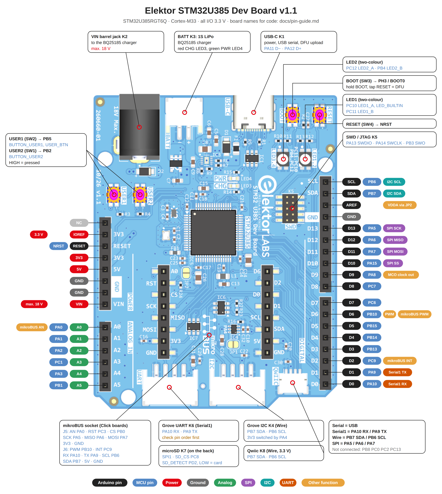

# Elektor STM32U385 Dev Board: hardware v1.1 and Arduino software

This document collects everything about the board and its software in one
place, as source material for an article. It covers the hardware and what
changed in v1.1, the Arduino board package, the library, all nine examples
with code, how the button-free upload works, and the problems solved during
bring-up. Every code snippet here is taken from the repository and was built
with STM32duino 3.1.0 and arduino-cli 1.3.0.

Repository: <https://github.com/Saad-Imtiaz/Elektor-STM32U385-DevBoard>



---

## 1. The board at a glance

The Elektor STM32U385 Dev Board (project 260660) is an Arduino Uno-format
board built around ST's STM32U385RGT6Q, an ultra-low-power Cortex-M33 from
the new STM32U3 series.

| | |
|---|---|
| MCU | STM32U385RGT6Q: Arm Cortex-M33 with FPU, up to 96 MHz, 1 MB flash, 256 KB SRAM, LQFP64, SMPS version (suffix Q) |
| USB | USB-C, full speed. USB CDC serial for sketches, ROM DFU bootloader for uploads |
| Clocks | Internal MSIS at 96 MHz (default), HSI48 with clock recovery for USB, 16 MHz HSE crystal (X1), 32.768 kHz LSE crystal (X2) |
| Power | USB-C, VIN / barrel jack up to **18 V**, 1S LiPo with BQ25185 charger, TLV75733 3.3 V LDO, on-chip SMPS for the core supply |
| User interface | 2 two-channel LEDs (4 channels in total), USER1, USER2, BOOT and RESET buttons, power and charge LEDs |
| Connectors | Arduino Uno headers, mikroBUS socket, Grove I2C (switched power), Grove-style UART header, Qwiic, microSD slot, SWD header (K5), LiPo connector |
| Logic level | 3.3 V on every pin |

### Power section

- **USB-C (K1):** sink with 5.1 kΩ CC resistors, F1 750 mA polyfuse, diode D1
  into the BQ25185 charger (IC3).
- **VIN / barrel jack (K2):** through D2 into the same charger input,
  **maximum 18 V**.
- **1S LiPo (K3):** on the charger's BAT pin. The red LED3 shows charging.
- **3V3 rail:** from the charger's SYS output through the TLV75733 LDO (IC2).
  The green LED4 shows power.
- **VDDA:** +3V3 through ferrite FB1. AREF (J4-8) connects to it only when
  JP2 is bridged.
- **Core supply:** the MCU is the SMPS version, and the step-down parts are
  fitted (L1 2.2 µH, C13/C15/C18 on VDD11). The software starts on the
  internal LDO and can switch to the SMPS at run time (`Board.useSMPS()`).

---

## 2. What changed in board v1.1

| | v1.0 | v1.1 |
|---|---|---|
| Button position | Hard to reach | RESET and BOOT on the left edge next to USB-C; USER1 and USER2 at the bottom left next to the barrel jack. Much easier to press |
| MCU pins | | Unchanged |

Because no MCU pin moved, **the same board package, library and examples
work on v1.0 and v1.1 without any change**. The v1.1 PCB was checked against
the software:

| Part | Designator | MCU pin |
|---|---|---|
| USER1 | SW2 | PB5 (IC pin 57) |
| USER2 | SW1 | PB2 (IC pin 26) |
| BOOT | SW3 | PH3 / BOOT0 (IC pin 60) |
| RESET | SW4 | NRST |
| LED1 | LED1 | PC10, PC11 (IC pins 51, 52) |
| LED2 | LED2 | PC12, PB4 (IC pins 53, 56) |

The full KiCad v1.1 project is in `hardware/`: schematic, PCB, project
libraries, 3D models, datasheets, an assembly drawing and a production ZIP
with Gerbers, drill and placement files.

---

## 3. Software overview

The software has two parts, both in `src/`:

```
src/
  board/                            board package, copied to
    boards.txt, platform.txt        <sketchbook>/hardware/elektor/stm32
    variants/U385_BOARD/            pin map, clock setup, button-free upload hook
    tools/dfu-upload.sh             upload script (dfu-util)
    tools/linux/99-elektor-u385.rules
  lib/
    Elektor_STM32U385_DevBoard/     Arduino library, copied to <sketchbook>/libraries
      library.properties
      src/U385Board.h, U385Board.cpp
      examples/00_LedCycle ... 08_MikroBus
```

1. **The board package** adds *Elektor STM32U385 Dev Board (260660)* to
   *Tools → Board*. It uses the official STM32duino core for compiling and
   adds what is specific to this board: every pin named after its job on the
   board, a 96 MHz clock setup with crystal-free USB, a 16 KB stack and a
   USB upload, with an optional mode that needs no button presses.
2. **The library**, *Elektor STM32U385 Dev Board* (`#include <U385Board.h>`),
   adds a `Board` object with LED helpers, debounced buttons, run-time clock
   switching, clock output, SMPS control and chip information (unique ID,
   reset cause, die temperature, VDDA).

Why a separate package and not a patch to STM32duino? STM32duino supports the
U3 from version 3.1.0, but only with a generic variant where every pin is
`PA5` or `PC10`. A board package of our own installs by copying two folders,
updates with `git pull` and leaves the official core untouched.

---

## 4. Installation

The `src` folder of the repository is laid out the way Arduino expects, so
installing is mostly copy and paste:

```
src/
  Arduino15/packages/     the board package   → paste into the Arduino15 folder
  Arduino/libraries/      the library         → paste into the sketchbook
```

Five steps get a new board running. On Windows,
[windows-install.md](windows-install.md) has the same steps with every
click spelled out.

### 4.1 STM32 boards

In *File → Preferences → Additional boards manager URLs*, add:

```
https://github.com/stm32duino/BoardManagerFiles/raw/main/package_stmicroelectronics_index.json
```

Then install **STM32 MCU based boards** 3.1.0 or newer from the Boards
Manager. 3.1.0 is the first version with STM32U3 support.

### 4.2 Board package and library

Copy two folders from `src`; each merges with the folder already there:

| Copy this | Windows | Linux | macOS |
|---|---|---|---|
| `src/Arduino15/packages` | `%LOCALAPPDATA%\Arduino15` | `~/.arduino15` | `~/Library/Arduino15` |
| `src/Arduino/libraries` | `Documents\Arduino` | `~/Arduino` | `~/Documents/Arduino` |

To keep the install up to date with `git pull`, link the folders instead
of copying them ([src/README.md](../src/README.md) has the commands).

### 4.3 dfu-util

The upload uses dfu-util 0.9 or newer, which STM32duino does not include.
On Linux it is `sudo apt install dfu-util`, on macOS
`brew install dfu-util`. On Windows, copy `dfu-util.exe` and
`libusb-1.0.dll` from the official binaries into the board package's
`tools\win` folder; the upload script looks there first, so `PATH` doesn't
need changing.

### 4.4 USB access

Once per computer. Windows needs the WinUSB driver for the *STM32
BOOTLOADER* device, installed with Zadig while the board is in DFU mode.
Linux needs the udev rule from the board package:

```sh
sudo cp src/Arduino15/packages/elektor/hardware/stm32/1.0.0/tools/linux/99-elektor-u385.rules /etc/udev/rules.d/
sudo udevadm control --reload-rules && sudo udevadm trigger
```

macOS needs nothing.

### 4.5 First upload

Put the board into DFU mode: hold **BOOT**, press and release **RESET**,
release **BOOT**. Select *Tools → Board → Elektor STM32U385 Dev Board
(260660)* and upload *File → Examples → Elektor STM32U385 Dev Board →
00_LedCycle*. Every upload works like this with the default *Upload method*,
**USB DFU (board already in DFU mode)**.

The optional **USB DFU (auto-reset, no buttons, wears option bytes)** method
needs no buttons at all (section 8). It is not the default because every
upload writes the option bytes twice, and they are rated for about 10,000
writes: roughly 5,000 uploads.

### 4.6 Tools menu

| Menu | Options |
|---|---|
| Upload method | **USB DFU (board already in DFU mode)** (default) · USB DFU (auto-reset, no buttons, wears option bytes) · STM32CubeProgrammer (SWD, K5 header) |
| USB support | **CDC (generic 'Serial' supersede U(S)ART)** (default, `Serial` = USB) · CDC (no generic 'Serial') · HID (keyboard and mouse) · None |
| U(S)ART support | **Enabled (generic Serial)** · Enabled (no generic Serial) · Disabled |
| Optimize, Debug symbols, C runtime library | As in STM32duino |

---

## 5. The board package

### 5.1 Pin names

The variant gives every pin three names that all work: the Arduino number,
the Arduino name and the STM32 name. These three lines drive the same pin,
the D13 header pin (PA5):

```cpp
digitalWrite(13, HIGH);     // Arduino number
digitalWrite(D13, HIGH);    // Arduino name
digitalWrite(PA5, HIGH);    // STM32 name
```

The Uno headers are numbered as on any Uno, each number mapped to the STM32
pin wired to that header position:

| Header | STM32 | Header | STM32 | Header | STM32 |
|---|---|---|---|---|---|
| D0 (RX) | PA10 | D6 | PB10 | D12 (MISO) | PA6 |
| D1 (TX) | PA9 | D7 | PC6 | D13 (SCK) | PA5 |
| D2 | PC9 | D8 | PC7 | D14 (SDA) | PB7 |
| D3 | PB13 | D9 (MCO) | PA8 | D15 (SCL) | PB6 |
| D4 | PB14 | D10 (SS) | PA15 | A0 / A1 / A2 | PA0 / PA1 / PA2 |
| D5 | PB15 | D11 (MOSI) | PA7 | A3 / A4 / A5 | PC1 / PA3 / PB1 |

The mapping was verified for every header pin with a test sketch of
compile-time checks like these:

```cpp
static_assert(D13 == PA5, "D13 must be PA5");
static_assert(A3  == PC1, "A3 must be PC1");
```

On top of that, every on-board part has a name, so a sketch never needs the
schematic:

| Name | Pin | What |
|---|---|---|
| `LED1_A` (`LED_BUILTIN`), `LED1_B` | PC10, PC11 | LED1, active high |
| `LED2_A`, `LED2_B` | PC12, PB4 | LED2, active high |
| `BUTTON_USER1` (`USER_BTN`) | PB5 | USER1 (SW2), HIGH when pressed |
| `BUTTON_USER2` | PB2 | USER2 (SW1), HIGH when pressed |
| `BUTTON_PRESSED` | | Level of a pressed button (HIGH) |
| `GROVE_I2C_POWER` | PA4 | HIGH switches 3V3 on at the Grove I2C socket K4 (TPS22919 load switch) |
| `SD_CS`, `SD_DETECT` | PC8, PD2 | microSD in SPI mode; detect reads LOW with a card in |
| `MIKROBUS_AN`, `_RST`, `_CS`, `_PWM`, `_INT` | PA0, PC3, PB0, PB10, PC9 | mikroBUS socket J5/J6 |
| `MCO_PIN` | PA8 (D9) | Clock output |

### 5.2 Serial ports and buses

| Object | Pins | Connected to |
|---|---|---|
| `Serial` | USB | USB-C virtual COM port |
| `Serial1` | PA10 RX, PA9 TX | D0/D1, UART header K6, mikroBUS J6 |
| `Wire` | PB7 SDA, PB6 SCL | Grove I2C K4, Qwiic K8, mikroBUS, header; 4.7 kΩ pull-ups on board |
| `SPI` | PA5 SCK, PA6 MISO, PA7 MOSI, SS PA15 | D10–D13, mikroBUS J5, microSD |

`tone()` and `Servo` use the basic timers TIM6 and TIM7, so they do not take
away a PWM pin.

### 5.3 Plain Arduino, no library

The pin names alone are enough for simple sketches:

```cpp
void setup() {
  pinMode(LED1_A, OUTPUT);
  pinMode(BUTTON_USER1, INPUT);           // external 10k pull-down on board
}
void loop() {
  digitalWrite(LED1_A, digitalRead(BUTTON_USER1) == BUTTON_PRESSED);
}
```

### 5.4 Clock setup

The variant's `SystemClock_Config()` runs the core at 96 MHz from the
internal MSIS oscillator, with voltage range 1, the EPOD booster on and two
flash wait states. USB takes its 48 MHz from HSI48, trimmed by the clock
recovery system (CRS) against the USB start-of-frame packets, so USB works
without a crystal. The two crystals stay off until a sketch needs them.

```cpp
HAL_RCCEx_EpodBoosterClkConfig(RCC_EPODBOOSTER_SOURCE_MSIS, RCC_EPODBOOSTER_DIV1);
HAL_PWREx_EnableEpodBooster();
HAL_PWREx_ControlVoltageScaling(PWR_REGULATOR_VOLTAGE_SCALE1);
__HAL_FLASH_SET_LATENCY(FLASH_LATENCY_2);

RCC_OscInitStruct.OscillatorType = RCC_OSCILLATORTYPE_HSI48 | RCC_OSCILLATORTYPE_HSI
                                   | RCC_OSCILLATORTYPE_MSIS;
RCC_OscInitStruct.MSISSource = RCC_MSI_RC0;      // 96 MHz
RCC_OscInitStruct.MSISDiv    = RCC_MSI_DIV1;
...
RCC_ClkInitStruct.SYSCLKSource = RCC_SYSCLKSOURCE_MSIS;
...
PeriphClkInit.IclkClockSelection = RCC_ICLKCLKSOURCE_HSI48;
PeriphClkInit.Usb1ClockSelection = RCC_USB1CLKSOURCE_ICLK;
```

### 5.5 Stack size

The board package ships its own linker script with a 16 KB stack:

```
_Min_Stack_Size = 0x4000; /* required amount of stack */
```

STM32duino 3.1.0 sets 1 KB for the U3, and its startup code turns that into a
hard limit in the Cortex-M33 MSPLIM register. Section 10.8 tells how that was
found.

---

## 6. The library: `U385Board.h`

```cpp
#include <U385Board.h>

void setup() {
  Serial.begin(115200);
  Board.begin();                    // LEDs off, buttons as inputs
}

void loop() {
  Board.update();                   // debounce the buttons, call every loop
  if (Board.pressed(USER1)) Board.ledToggle(0);
  if (Board.heldFor(USER2) > 1000) Board.ledsAll(true);
}
```

The library checks the board at compile time and stops with a clear message
if another board is selected:

```cpp
#if !defined(ARDUINO_U385_BOARD)
  #error "U385Board needs the board 'Elektor STM32U385 Dev Board (260660)' selected in Tools > Board."
#endif
```

### 6.1 Function reference

| Area | Functions |
|---|---|
| Set-up | `begin()` |
| LEDs (index 0–3 = PC10, PC11, PB4, PC12) | `led(i, on)`, `ledToggle(i)`, `ledState(i)`, `ledsOff()`, `ledsAll(on)`, `ledsShow(bits)`, `ledPin(i)` |
| Buttons (`USER1`, `USER2`) | `update()`, `isDown(b)`, `pressed(b)`, `released(b)`, `heldFor(b)`, `readRaw(b)`, `releasedLevel(b)`, `setDebounce(ms)` |
| Board | `groveI2CPower(on)`, `sdCardPresent()`, `enterBootloader()`, `useSMPS(on)`, `smpsActive()` |
| Clocks | `setSystemClock(SYSCLK_96MHZ … SYSCLK_3MHZ)`, `systemClock()`, `hclk()`, `pclk1()`, `pclk2()`, `pclk3()`, `systemClockSource()`, `startLSE()`, `startHSE()`, `msiPllLock()`, `clockOut(source, div)`, `printClocks(Serial)` |
| Chip | `uniqueId()`, `flashSizeKB()`, `resetCause()`, `temperatureC()`, `vdda()` |

### 6.2 LEDs

The four LED channels are indexed 0 to 3 in the order they sit on the board.
`ledsShow()` sets all four at once from the low four bits of a number:

```cpp
Board.led(0, true);        // LED1_A (PC10) on
Board.ledToggle(3);        // LED2_A (PC12)
Board.ledsShow(0b0101);    // index 0 and 2 on, 1 and 3 off
Board.ledsAll(false);
```

### 6.3 Buttons

`update()` reads and debounces both buttons (25 ms by default). The events
then come from these calls:

```cpp
Board.update();
if (Board.pressed(USER1))  { /* once per press   */ }
if (Board.released(USER1)) { /* once per release */ }
if (Board.isDown(USER2))   { /* while held       */ }
if (Board.heldFor(USER1) >= 1000) { /* long press */ }
```

`begin()` takes the level each button has at start-up as "released". So the
library works whichever way the buttons are wired, as long as no button is
held while the sketch starts.

### 6.4 Clocks

```cpp
Board.setSystemClock(SYSCLK_24MHZ);  // 96, 48, 24, 12, 6 or 3 MHz
Serial1.begin(115200);               // re-run so the baud divider follows
Board.msiPllLock();                  // lock MSI to the 32.768 kHz crystal
Board.clockOut(MCO_SYSCLK, 16);      // SYSCLK / 16 on D9 (PA8)
Board.printClocks(Serial);
```

| Speed | Source | Voltage range | EPOD booster | Flash wait states |
|---|---|---|---|---|
| 96 MHz | MSIRC0 / 1 | 1 | on | 2 |
| 48 MHz | MSIRC0 / 2 | 1 | on | 1 |
| 24 MHz | MSIRC1 / 1 | 2 | off | 1 |
| 12 MHz | MSIRC1 / 2 | 2 | off | 0 |
| 6 MHz | MSIRC1 / 4 | 2 | off | 0 |
| 3 MHz | MSIRC1 / 8 | 2 | off | 0 |

`millis()` and `delay()` follow the new clock automatically. USB needs at
least 12 MHz; at 6 and 3 MHz the USB serial port stops until the clock goes
back up. `msiPllLock()` takes the MSI from about ±1 % to crystal accuracy.
MCO sources: `MCO_SYSCLK`, `MCO_MSIS`, `MCO_HSI16`, `MCO_HSE`, `MCO_HSI48`,
`MCO_LSI`, `MCO_LSE`, divided by 1, 2, 4, 8 or 16.

### 6.5 Chip information and power

```cpp
Serial.println(Board.uniqueId());       // 96-bit ID as 24 hex characters
Serial.println(Board.flashSizeKB());    // 1024
Serial.println(Board.resetCause());     // "power-on", "pin", "software", ...
Serial.println(Board.temperatureC(), 1);
Serial.println(Board.vdda(), 3);        // measured against VREFINT

Board.groveI2CPower(true);              // 3V3 on at Grove K4
if (Board.sdCardPresent()) { ... }
Board.useSMPS(true);                    // core supply from the SMPS
Board.enterBootloader();                // same as BOOT + RESET
```

`useSMPS()` switches the core supply from the LDO to the on-board SMPS.
Switching was tested both ways at 96 MHz; the current saving has not been
measured yet.

---

## 7. The examples

All nine are under *File → Examples → Elektor STM32U385 Dev Board*. The
serial examples work with the Serial Monitor at any baud rate except 1200
(which starts an upload). Every example that uses a button also has a serial
command for the same thing.

| Example | What it shows | Tested on hardware |
|---|---|---|
| `00_LedCycle` | Seven LED patterns | Yes |
| `01_LedCycleButtons` | LEDs stepped with USER1/USER2, long press | Serial output yes, buttons not yet tested |
| `02_SerialMonitor` | USB serial command shell | Yes |
| `03_BoardInfo` | Clocks, ID, reset cause, temperature, VDDA | Yes |
| `04_ClockSwitch` | SYSCLK 96 → 12 MHz at run time, MSI-PLL, MCO | Yes |
| `05_LowPowerModes` | Sleep, Stop and Shutdown with RTC or button wake-up | RTC wake yes, button wake not yet tested |
| `06_GroveI2CScanner` | Grove power switch and I2C scan | Yes |
| `07_SDCard` | microSD with SdFat, FAT16/FAT32/exFAT, hot-plug | Yes, 64 GB SDXC exFAT |
| `08_MikroBus` | Click board test tool and USB-to-UART bridge | Yes, socket empty |

### 7.1 `00_LedCycle`: seven LED patterns

The four LEDs run through chase, bounce, fill and empty, alternate, LED1
against LED2, a binary count and a flash, about 20 s per round. No buttons
needed. The full sketch:

```cpp
#include <U385Board.h>

// Show an LED pattern, then wait
void show(uint8_t bits, uint32_t ms)
{
  Board.ledsShow(bits);
  delay(ms);
}

void setup()
{
  Board.begin();          // LEDs as outputs, all off
}

void loop()
{
  // 1. Chase, three rounds
  for (int r = 0; r < 3; r++)
    for (int i = 0; i < 4; i++) show(1 << i, 120);

  // 2. Bounce, three rounds
  for (int r = 0; r < 3; r++) {
    for (int i = 0; i < 4; i++) show(1 << i, 90);
    for (int i = 2; i > 0; i--) show(1 << i, 90);
  }

  // 3. Fill up, then empty, twice
  for (int r = 0; r < 2; r++) {
    for (int i = 1; i <= 4; i++) show((1 << i) - 1, 150);
    for (int i = 3; i >= 0; i--) show((1 << i) - 1, 150);
  }

  // 4. Alternate: LEDs 0+2 against 1+3
  for (int r = 0; r < 6; r++) { show(0b0101, 200); show(0b1010, 200); }

  // 5. LED1 (PC10, PC11) against LED2 (PB4, PC12)
  for (int r = 0; r < 6; r++) { show(0b0011, 200); show(0b1100, 200); }

  // 6. Binary count 0 to 15
  for (int n = 0; n < 16; n++) show(n, 180);

  // 7. All four flash together
  for (int r = 0; r < 5; r++) { show(0b1111, 150); show(0, 150); }

  show(0, 400);           // short pause before the next round
}
```

### 7.2 `01_LedCycleButtons`: short and long presses

One LED is lit at a time. USER1 steps forward, USER2 steps back, and holding
USER1 for one second toggles auto-run. The trick is telling a long press
from a short one: the long press is handled while the button is still down,
and the release only counts as "next" if no long press happened.

```cpp
void loop()
{
  Board.update();

  // Long press on User1 toggles auto-run (handled once per hold)
  if (Board.heldFor(USER1) >= 1000 && !holdHandled) {
    holdHandled = true;
    autoRun = !autoRun;
    Board.ledsAll(true);                        // short flash to confirm
    delay(150);
    show(current);
  }

  if (Board.released(USER1)) {
    if (!holdHandled) {                         // short press = next
      current = (current + 1) % U385_LED_COUNT;
      show(current);
    }
    holdHandled = false;
  }

  if (Board.pressed(USER2)) {                   // previous
    current = (current + U385_LED_COUNT - 1) % U385_LED_COUNT;
    show(current);
  }

  if (autoRun && millis() - lastStep >= 250) {
    lastStep = millis();
    current = (current + 1) % U385_LED_COUNT;
    Board.ledsOff();
    Board.led(current, true);
  }
}
```

Every button event is also printed on the serial port, with the raw pin
level and the level the library took as "released", which makes a wiring
fault easy to spot.

### 7.3 `02_SerialMonitor`: a command shell over USB

USB serial needs no adapter. The sketch waits up to 3 s for the Serial
Monitor (blinking an LED meanwhile) and then takes one-letter commands:
`1`–`4` toggle an LED, `a` all on, `o` all off, `c` clock tree, `i` board
info, `b` reboot into the DFU bootloader. A heartbeat line every 5 s shows
the LED states and the die temperature.

```cpp
void setup()
{
  Board.begin();
  Serial.begin(115200);

  // Wait up to 3 s for the Serial Monitor so the banner is not lost
  uint32_t t0 = millis();
  while (!Serial && millis() - t0 < 3000) {
    Board.ledToggle(0);
    delay(100);
  }
  Board.ledsOff();
}

void loop()
{
  Board.update();
  if (Board.pressed(USER1)) Serial.println(F("User1 (SW2) pressed"));

  while (Serial.available()) {
    char c = Serial.read();
    switch (c) {
      case '1': case '2': case '3': case '4': {
        uint8_t i = c - '1';
        Board.ledToggle(i);
        Serial.print(F("LED ")); Serial.print(i + 1);
        Serial.println(Board.ledState(i) ? F(" on") : F(" off"));
        break;
      }
      case 'a': Board.ledsAll(true); break;
      case 'o': Board.ledsOff();     break;
      case 'c': Board.printClocks(Serial); break;
      case 'i': info(); break;
      case 'b':
        Serial.println(F("Rebooting into the DFU bootloader..."));
        Serial.flush();
        delay(100);
        Board.enterBootloader();
        break;
    }
  }
}
```

### 7.4 `03_BoardInfo`: what the chip knows about itself

Prints the unique ID, flash size, reset cause and the clock tree once, then
every 2 s the die temperature, VDDA, active regulator, card detect and both
buttons. The LEDs show the temperature as a bar graph, one LED per 5 °C above
20 °C.

```cpp
float t = Board.temperatureC();
float v = Board.vdda();
Serial.print(F("T = ")); Serial.print(t, 1);
Serial.print(F(" C | VDDA = ")); Serial.print(v, 3);
Serial.print(F(" V | Reg: ")); Serial.print(Board.smpsActive() ? F("SMPS") : F("LDO"));
Serial.print(F(" | SD: ")); Serial.println(Board.sdCardPresent() ? F("card") : F("none"));

int bars = (int)((t - 20.0f) / 5.0f) + 1;
bars = constrain(bars, 0, 4);
Board.ledsShow((1U << bars) - 1);          // 0..4 LEDs lit
```

### 7.5 `04_ClockSwitch`: changing speed at run time

`n` or USER1 steps SYSCLK 96 → 48 → 24 → 12 MHz; `l` or USER2 locks the MSI
to the 32.768 kHz crystal. LED1_A keeps blinking at 1 Hz at every speed,
because `millis()` follows the clock, while a loop counter printed every
second shows how much work the CPU gets done. SYSCLK / 16 goes out on D9 for a
scope or frequency counter: 6 MHz at 96 MHz, 750 kHz at 12 MHz.

```cpp
const U385SysClock speeds[] = { SYSCLK_96MHZ, SYSCLK_48MHZ, SYSCLK_24MHZ, SYSCLK_12MHZ };

void nextSpeed()
{
  speedIndex = (speedIndex + 1) % 4;
  Serial.flush();                                   // finish sending first
  bool ok = Board.setSystemClock(speeds[speedIndex]);
  Serial.println(ok ? F("done") : F("FAILED"));
  Board.printClocks(Serial);
}

void lockToLSE()
{
  Serial.println(Board.msiPllLock() ? F("locked") : F("failed (is X2 fitted?)"));
}

void setup()
{
  Board.begin();
  Serial.begin(115200);
  Board.clockOut(MCO_SYSCLK, 16);                   // SYSCLK / 16 on D9
}

void loop()
{
  loops++;
  Board.update();
  if (Board.pressed(USER1)) nextSpeed();
  if (Board.pressed(USER2)) lockToLSE();
  ...
  if (millis() - lastReport >= 1000) {
    lastReport = millis();
    Serial.print(Board.systemClock() / 1000000UL);
    Serial.print(F(" MHz: "));
    Serial.print(loops);
    Serial.println(F(" loops/s"));
    loops = 0;
  }
}
```

### 7.6 `05_LowPowerModes`: Sleep, Stop and Shutdown

Needs *STM32duino Low Power* and *STM32duino RTC*. Choose a mode with `1`,
`2`, `3` (or USER1), start it with `s` (or USER2). The board wakes up after
10 s from the RTC alarm, clocked by the 32.768 kHz crystal, or earlier on a
button press: both buttons are PWR wake-up lines (PB5 = WKUP6, PB2 = WKUP1).

| Mode | What stops | Wakes up |
|---|---|---|
| Sleep | CPU only, USB stays up | Where it left off |
| Deep sleep (Stop) | Clocks off, RAM kept, USB detached | Where it left off |
| Shutdown | Almost everything, RAM lost | Restarts the sketch |

Set-up of the RTC and the button wake-up:

```cpp
STM32RTC &rtc = STM32RTC::getInstance();

rtc.setClockSource(STM32RTC::LSE_CLOCK);    // crystal-accurate wake-up
rtc.begin();
LowPower.begin();

// Wake on the edge opposite to the "released" level, in every mode
PinStatus edge = (Board.releasedLevel(USER1) == LOW) ? RISING : FALLING;
LowPower.attachInterruptWakeup(BUTTON_USER1, onButtonWake, edge, SHUTDOWN_MODE);
```

Going to sleep:

```cpp
switch (mode) {
  case MODE_SLEEP:
    // USB raises an interrupt every 1 ms (start of frame), and any
    // interrupt ends Sleep. So sleep again until 10 s are over.
    while (!wokeByButton && rtc.getEpoch() - t0 < SLEEP_MS / 1000) {
      LowPower.sleep();
    }
    break;
  case MODE_DEEPSLEEP:
    Serial.end();                     // detach USB before the bus clock stops
    LowPower.deepSleep(SLEEP_MS);
    break;
  case MODE_SHUTDOWN:
    Serial.end();
    LowPower.shutdown(SLEEP_MS);      // never returns: wake-up restarts the sketch
    break;
}
```

After Stop, USB is attached again and the sketch gives the PC 2.5 s to
re-enumerate the port before printing (section 10.6 explains why):

```cpp
Serial.begin(115200);
delay(2500);
waitForSerial();
```

After Shutdown the sketch starts from scratch, and `resetCause()` reports
"power-on / brown-out", which is how the chip flags a shutdown exit.

### 7.7 `06_GroveI2CScanner`: switched Grove power

The Grove I2C socket K4 gets its 3.3 V through a TPS22919 load switch on
PA4, so a sketch can power a module on and off. The scanner switches it on,
gives the module 50 ms and scans I2C1. The same bus goes to Qwiic, mikroBUS
and the SDA/SCL header pins, with 4.7 kΩ pull-ups on board. The LEDs show how
many devices were found; USER1 scans again.

```cpp
void setup()
{
  Board.begin();
  Serial.begin(115200);
  Board.groveI2CPower(true);    // TPS22919 load switch on
  delay(50);                    // let the module power up
  Wire.begin();
  Wire.setClock(100000);
  scan();
}

void scan()
{
  uint8_t found = 0;
  for (uint8_t addr = 0x08; addr < 0x78; addr++) {
    Wire.beginTransmission(addr);
    if (Wire.endTransmission() == 0) {
      Serial.print(F("  device at 0x"));
      if (addr < 0x10) Serial.print('0');
      Serial.println(addr, HEX);
      found++;
    }
  }
  Board.ledsShow(found > 4 ? 0x0F : (1U << found) - 1);
}
```

### 7.8 `07_SDCard`: microSD with exFAT

Needs *SdFat* by Bill Greiman. SdFat reads FAT16, FAT32 and exFAT, so cards
above 32 GB work as they come from the shop. The slot K7 runs in SPI mode on
the shared SPI1 bus, with chip select PC8 and card detect PD2.

At start-up and on every card insertion the sketch mounts the card, prints
type, size, file system and free space, lists the root folder and appends a
line with uptime, temperature and VDDA to `U385LOG.TXT`. Commands: `l` list,
`w` write, `r` read, `d` delete, `i` info. The card can be pulled and pushed
back in at any time.

```cpp
#include <U385Board.h>
#include <SdFat.h>

// The SPI bus is shared with the mikroBUS socket and the Arduino header.
#define SD_CONFIG SdSpiConfig(SD_CS, SHARED_SPI, SD_SCK_MHZ(12))

SdFs sd;                 // FAT16, FAT32 and exFAT

void appendLine()
{
  FsFile f;
  if (!f.open("U385LOG.TXT", O_WRONLY | O_CREAT | O_APPEND)) return;
  f.print(F("uptime_ms="));  f.print(millis());
  f.print(F(" temp_C="));    f.print(Board.temperatureC(), 1);
  f.print(F(" vdda_V="));    f.println(Board.vdda(), 3);
  f.close();                 // close() writes everything to the card
}

void loop()
{
  // Mount when a card goes in, forget it when it comes out.
  bool now = Board.sdCardPresent();
  if (now != present) {
    delay(300);                                   // let the contacts settle
    present = Board.sdCardPresent();
    if (present) {
      mounted = sd.begin(SD_CONFIG);
      if (mounted) { sd.ls(&Serial, LS_SIZE); appendLine(); }
    } else {
      sd.end();
      mounted = false;
    }
  }
}
```

Tested with a 64 GB SDXC card in exFAT.

### 7.9 `08_MikroBus`: Click board test tool

Every mikroBUS signal has a board name, so the sketch uses no pin numbers:

```
J5 (left)                      J6 (right)
1 AN    PA0  MIKROBUS_AN (A0)  1 PWM  PB10  MIKROBUS_PWM (D6)
2 RST   PC3  MIKROBUS_RST      2 INT  PC9   MIKROBUS_INT (D2)
3 CS    PB0  MIKROBUS_CS       3 RX   PA10  Serial1 RX (D0)
4 SCK   PA5  SPI               4 TX   PA9   Serial1 TX (D1)
5 MISO  PA6  SPI               5 SCL  PB6   Wire
6 MOSI  PA7  SPI               6 SDA  PB7   Wire
7 +3V3                         7 +5V
8 GND                          8 GND
```

Commands: `s` status (AN voltage, INT and RST level, INT edge count), `r`
reset the Click, `i` I2C scan, `j` SPI read-ID, `p` step the PWM duty cycle,
`b` change the UART speed, `u` USB-to-UART bridge for AT-command Clicks (GSM,
GNSS, Wi-Fi, LoRa, BLE); Ctrl+] leaves the bridge.

Set-up, keeping the microSD card off the shared SPI bus:

```cpp
pinMode(MIKROBUS_RST, OUTPUT);
digitalWrite(MIKROBUS_RST, HIGH);       // click running
pinMode(MIKROBUS_CS, OUTPUT);
digitalWrite(MIKROBUS_CS, HIGH);        // SPI chip not selected
pinMode(SD_CS, OUTPUT);
digitalWrite(SD_CS, HIGH);              // keep the microSD card off the shared SPI bus
attachInterrupt(digitalPinToInterrupt(MIKROBUS_INT), onInt, CHANGE);
analogReadResolution(12);
SPI.begin();
Wire.begin();
Serial1.begin(115200);
```

Reading the analog pin, scaled with the measured VDDA:

```cpp
uint32_t raw = analogRead(MIKROBUS_AN);
float volts = raw * Board.vdda() / 4095.0f;
```

SPI read-ID: JEDEC command 0x9F gives the chip ID on Flash, FRAM and many
other SPI Clicks:

```cpp
SPI.beginTransaction(SPISettings(1000000, MSBFIRST, SPI_MODE0));
digitalWrite(MIKROBUS_CS, LOW);
SPI.transfer(0x9F);
uint8_t id[3];
for (uint8_t i = 0; i < 3; i++) id[i] = SPI.transfer(0x00);
digitalWrite(MIKROBUS_CS, HIGH);
SPI.endTransaction();
```

The UART bridge passes everything both ways until Ctrl+] (0x1D):

```cpp
for (;;) {
  while (Serial.available()) {
    int c = Serial.read();
    if (c == 0x1D) return;              // Ctrl+]
    Serial1.write((uint8_t)c);
  }
  while (Serial1.available()) {
    Serial.write((uint8_t)Serial1.read());
  }
}
```

All signals were exercised with an empty socket; a real Click board has not
been tested yet.

---

## 8. DFU mode and uploading without buttons

Arduino boards with native USB, such as the Leonardo and the Zero, use the
"1200 baud touch": the IDE opens the serial port at 1200 baud and closes it,
the sketch sees that and resets into the bootloader. This board does the
same, but getting into the STM32U385's ROM bootloader from software took a
detour. It is an option (*Upload method → USB DFU (auto-reset, no buttons,
wears option bytes)*), not the default, because of the option-byte wear
described in section 8.3.

### 8.1 Why a jump does not work

The usual STM32 trick is to jump from the sketch straight into the ROM
bootloader. Its address comes from `FLASH->BOOT1R`: 0x0BF8F000 (0x0BF80000
reads as zeros, and other parts of system memory fault when read). The jump
runs, the bootloader starts, and then hands control straight back to the
sketch: the U3 ROM checks how the chip really booted, and a software jump
does not count.

### 8.2 What works: the option bytes

Two option bits, `nSWBOOT0` and `nBOOT0` (bits 26 and 27 of `FLASH_OPTR`),
decide whether the chip boots the user program or the ROM bootloader. The
sketch clears both and reloads the option bytes, which resets the chip into
a genuine ROM boot, exactly as if BOOT were held.

1. The IDE opens the USB serial port at 1200 baud and closes it.
2. A 1 ms SysTick hook in the variant notices it:
   ```cpp
   void HAL_SYSTICK_Callback(void)
   {
     static uint8_t touch_ms = 0;
     if (linecoding.bitrate == 1200 && !dtrState) {
       if (++touch_ms >= 50) {             /* let the USB control transfer finish */
         u385_enter_bootloader();
       }
     } else {
       touch_ms = 0;
     }
   }
   ```
3. The option bits are set to "boot from system memory" and reloaded:
   ```cpp
   static void u385_set_boot_option(uint32_t swboot0, uint32_t nboot0)
   {
     FLASH_OBProgramInitTypeDef ob = {};
     ob.OptionType = OPTIONBYTE_USER;
     ob.USERType = OB_USER_NSWBOOT0 | OB_USER_NBOOT0;
     ob.USERConfig = swboot0 | nboot0;

     __disable_irq();
     HAL_FLASH_Unlock();
     HAL_FLASH_OB_Unlock();
     __HAL_FLASH_CLEAR_FLAG(FLASH_FLAG_ALL_ERRORS);
     for (int attempt = 0; attempt < 2; attempt++) {
       if (HAL_FLASHEx_OBProgram(&ob) == HAL_OK) {
         HAL_FLASH_OB_Launch();            /* reloads option bytes and resets */
       }
       __HAL_FLASH_CLEAR_FLAG(FLASH_FLAG_ALL_ERRORS);
     }
     ...
   }

   void u385_enter_bootloader(void)
   {
     u385_set_boot_option(OB_BOOT0_FROM_OB, OB_NBOOT0_RESET);
     NVIC_SystemReset();                   /* fallback if the option write failed */
   }
   ```
4. `tools/dfu-upload.sh` waits for the DFU device, reads the option bytes,
   flashes the sketch without leaving DFU, then writes the option bytes back
   with the two bits set again. The bootloader reloads them, which starts the
   new sketch.
5. As a safety net, every sketch checks the bits before anything else runs
   and restores them if they are still cleared:
   ```cpp
   __attribute__((constructor(100))) static void u385_restore_boot_option(void)
   {
     if (u385_option_boot_is_sysmem()) {
       u385_set_boot_option(OB_BOOT0_FROM_PIN, OB_NBOOT0_SET);
     }
   }
   ```

Only those two bits are ever written; read protection and every other option
byte stay as they are. On the test board the option bytes read
`FLASH_OPTR = 0x1FEFF0AA` before and after every upload, and a full
button-free upload takes about 4.4 s.

### 8.3 Drawbacks

| | |
|---|---|
| Option-byte wear | Two option-byte writes per upload. Flash is rated for about 10,000 cycles, so roughly 5,000 uploads. For very heavy use, switch to the BOOT button method |
| Reset cause | After a button-free upload, the sketch reports "option byte load" as the reset reason |
| 1200 baud | Any program that opens the port at 1200 baud reboots the board into DFU |
| Needs a live sketch | Does not work if the sketch has crashed, is in Stop or Shutdown, has called `Serial.end()`, was built with USB set to HID or None, defines its own `HAL_SYSTICK_Callback()` or was not built with this package. Use BOOT + RESET then |
| Interrupted upload | The board keeps starting in DFU until the next successful upload. Nothing is lost |
| Power loss during the option-byte write | A window of a few milliseconds per upload. If it ever happens, repair the option bytes with STM32CubeProgrammer over DFU (BOOT button) or SWD (K5). Never seen in testing |

### 8.4 Manual recovery

If the board stays in DFU and should run the sketch already in flash, set
bits 26 and 27 by hand:

```sh
dfu-util -a 1 -d 0483:df11 -s 0x40022040:64 -U ob.bin
python3 -c "b=bytearray(open('ob.bin','rb').read()); b[3]|=0x0C; open('ob_fixed.bin','wb').write(b)"
dfu-util -a 1 -d 0483:df11 -s 0x40022040 -D ob_fixed.bin
```

### 8.5 Entering DFU mode: all the ways

DFU mode does not need an upload. Any of these puts a running board into the
ROM bootloader (`0483:df11 STM Device in DFU Mode` in `lsusb`), for example to
use STM32CubeProgrammer or to read the flash back with dfu-util.

| Way | Buttons | How |
|---|---|---|
| BOOT + RESET | Yes | Hold BOOT, press and release RESET, release BOOT. Or hold BOOT while plugging in USB. Always works |
| Upload from the IDE | No | *Upload method → USB DFU (auto-reset)*; the IDE does the 1200 baud touch itself |
| 1200 baud touch from a terminal | No | Open the board's serial port at 1200 baud and close it (below) |
| Serial command | No | Send `b` to `02_SerialMonitor` |
| From your own sketch | No | Call `Board.enterBootloader()` |

The 1200 baud touch from a terminal, Linux (the port is `/dev/ttyACM0` here):

```sh
stty -F /dev/ttyACM0 1200
```

macOS uses `stty -f /dev/cu.usbmodemXXXX 1200`. On any system with Python and
pyserial:

```sh
python3 -c "import serial; serial.Serial('/dev/ttyACM0', 1200).close()"   # Windows: 'COM5'
```

From your own sketch, for example on a long press of USER1:

```cpp
Board.update();
if (Board.heldFor(USER1) > 3000) {
  Serial.println(F("Rebooting into DFU..."));
  Serial.flush();
  delay(100);
  Board.enterBootloader();     // does not return
}
```

All the button-free ways use the option bytes (section 8.2). Tested on the
board: after `stty -F /dev/ttyACM0 1200` the board came up in DFU within a
second, and `FLASH_OPTR` read `0x13EFF0AA`, which is the normal `0x1FEFF0AA`
with the two boot bits cleared.

### 8.6 Leaving DFU mode

How to get out depends on how the board got in.

**Entered with BOOT + RESET:** the option bytes were not touched, so
anything that resets the chip without BOOT held starts the sketch again:

- press RESET, or
- unplug and replug USB, or
- upload a sketch (the upload starts it at the end).

**Entered without buttons (IDE, terminal touch, `b`, `enterBootloader()`):**
the two boot bits are cleared, so the chip boots into DFU on **every** reset
until they are set again. RESET, replugging USB and a dfu-util `:leave`
request all bring it straight back into DFU. Tested: a dfu-util `leave`
reset the chip, and it came back as `0483:df11` again. Three ways out:

1. **Upload a sketch.** This is the normal way. `dfu-upload.sh` sees the
   cleared bits, flashes the sketch and sets the bits again, and the sketch
   starts. Both upload methods do this, so with the board already in DFU use
   the default *USB DFU (board already in DFU mode)*:
   ```sh
   arduino-cli compile --upload -b elektor:stm32:u385board mysketch
   ```
   Tested: after the terminal touch above, this upload ended with "Upload
   done, sketch is starting." and the board was back on its USB serial port.
2. **Keep the sketch already in flash:** set the two bits by hand with
   dfu-util (section 8.4). Writing the option bytes resets the chip into
   the existing sketch.
3. **STM32CubeProgrammer:** connect over USB DFU or SWD (K5), open *Option
   bytes → User configuration*, tick `nSWBOOT0` and `nBOOT0`, and apply.

Every sketch built with this board package also checks the two bits as the
very first thing it does and sets them back if they are cleared. So once a
sketch runs, by any route, the board is back to normal.

---

## 9. Pinout drawing

The pinout drawing (`docs/pinout.png`, `docs/pinout.svg`) is generated by
`docs/make_pinout.py` from the v1.1 board render `docs/board-top.png`. It
labels every header pin with its Arduino name and STM32 pin, and points to
each connector, LED and button at its v1.1 position. For a future board
revision, only the pixel positions in the script need updating.

---

## 10. Bring-up: problems and how they were solved

The full story is in [problems-and-solutions.md](problems-and-solutions.md).
In short:

1. **No tools on the bench.** The xPack GCC toolchain, arduino-cli 1.3.0,
   dfu-util 0.11 and the STM32duino core were installed by hand. The first
   dfu-util run failed with `LIBUSB_ERROR_ACCESS` until a udev rule was added
   for the bootloader (0483:df11) and the sketch's serial port (0483:5740).
   The STM32duino core does not include dfu-util, despite older notes saying
   it does.
2. **A new chip with little reference code.** A bare-metal test with CMSIS
   and TinyUSB proved the hardware first. Most code online is for the U5 or
   L4, and names differ on the U3: no `__HAL_RCC_MSIRC0_ENABLE`, boot address
   registers `BOOT0R`/`BOOT1R` instead of `NSBOOTADDx`, `ECCCR` instead of
   `ECCR`. Read the U3 header, not a U5 forum post.
3. **Arduino support for the U3.** STM32duino 3.1.0 has only a generic
   U375/U385 variant, so a board package with board pin names, a clock setup
   and the library was written on top of it.
4. **Uploading without BOOT.** Section 8: the ROM ignores a software jump,
   the option bytes work. An occasional rejected option-byte write was fixed
   by clearing the flash error flags first and allowing one retry.
5. **Changing the clock at run time.** Three things must happen in the right
   order: flash wait states (raised before speeding up, lowered only after
   slowing down), the voltage range (range 1 up to 96 MHz, range 2 up to
   48 MHz) and the EPOD booster (on above 24 MHz). Wrong order means the CPU
   runs from flash faster than flash allows, and crashes that look random.
6. **Low-power modes.** Sleep woke up at once: USB start-of-frame interrupts
   every millisecond end it, so the example sleeps in a loop. After Stop the
   "woke up" message was lost because STM32duino's `Serial.end()` does not
   clear the DTR flag, so the sketch printed before the PC had reopened the
   port; it now waits 2.5 s.
7. **The microSD card.** "No FAT16/FAT32 partition found": the 64 GB SDXC
   card came formatted exFAT, which the Arduino SD library cannot read. The
   example moved to SdFat. A trap on the way: `SD.begin(clock, cs)` takes the
   clock in hertz, so the old `SPI_HALF_SPEED` constant asks for 1 Hz.
8. **The freeze.** Creating a file with SdFat locked the chip up so hard that
   USB died, and a fault catcher in the TAMP backup registers never fired.
   The cause: STM32duino's U3 startup code puts the 1 KB `_Min_Stack_Size`
   into the Cortex-M33 MSPLIM register. Past it, the chip faults, needs stack
   to handle the fault, finds none and locks up. SdFat's 512-byte sector
   buffer on the stack was enough. The fix is a 16 KB stack in the board's
   linker script. Tip: if a Cortex-M33 freezes so hard that USB dies and the
   fault handler never runs, check the stack limit first.

---

## 11. Status and open items

| Part | Status |
|---|---|
| LEDs, USB serial, button-free upload | Working |
| Clock switching 96 to 12 MHz, MSI locked to the 32.768 kHz crystal | Working |
| Sleep, Stop, Shutdown with RTC wake-up | Working |
| SMPS core supply (`Board.useSMPS()`) | Switches both ways; current saving not measured yet |
| microSD (64 GB, exFAT) | Working |
| Grove I2C power switch and scan | Working, no device connected yet |
| mikroBUS socket | All signals exercised with an empty socket; no Click board tested yet |
| USER1 / USER2 buttons | Not tested yet on v1.1 |
| Windows, Arduino IDE 2.x | Copy-and-paste install, DFU upload and button-free upload all work |
| macOS | Not tested yet |

Other things to know:

- **A sketch that disables USB, crashes or sleeps** cannot be reset into DFU
  from the IDE. Use BOOT + RESET.

---

## 12. Further reading in the repository

| Document | Content |
|---|---|
| [README.md](../README.md) | Overview, pin names, library, examples, known issues |
| [src/README.md](../src/README.md) | Install guide with every step |
| [pin-guide.md](pin-guide.md) | Every header pin, connector, on-board part and the power section |
| [uploading.md](uploading.md) | How the button-free upload works, recovery |
| [problems-and-solutions.md](problems-and-solutions.md) | The bring-up story in full |
| [hardware/README.md](../hardware/README.md) | KiCad v1.1 project files |
| [U385Board.h](../src/Arduino/libraries/Elektor_STM32U385_DevBoard/src/U385Board.h) | Library reference with a comment on every function |

License: board package, library, examples and docs under MIT.
`PeripheralPins.c`, `PinNamesVar.h` and `ldscript.ld` come from STM32duino and
remain © STMicroelectronics under BSD-3-Clause.
