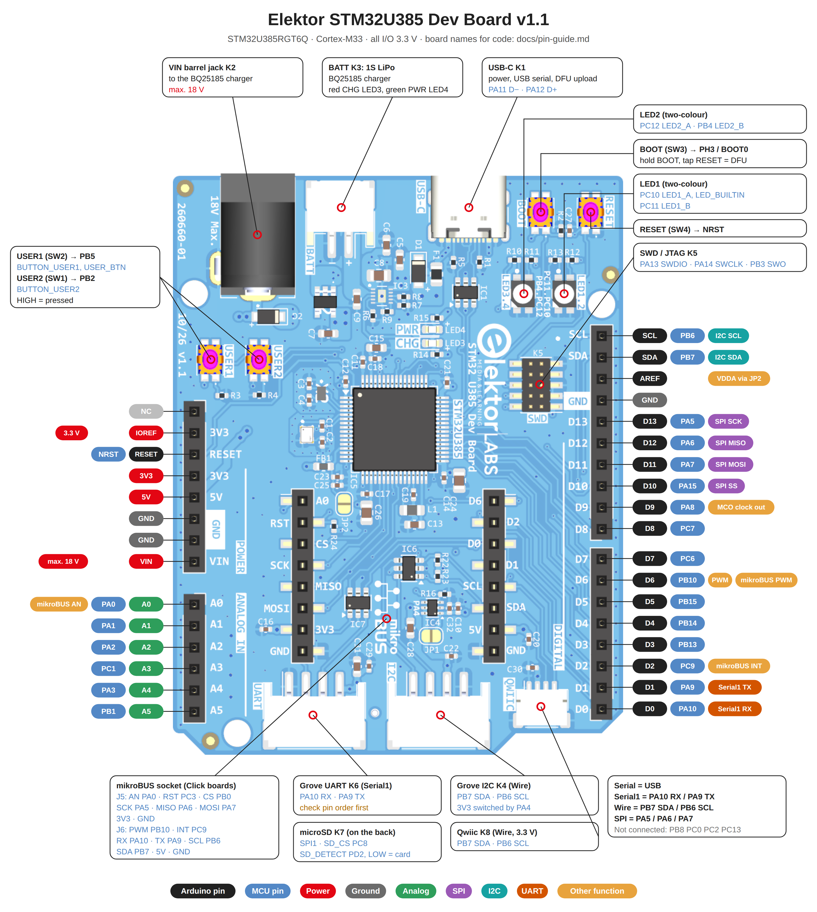

# Pin guide: Elektor STM32U385 Dev Board

MCU: STM32U385RGT6Q (IC6), schematic 260660-002, Rev 1.0.
Logic level is 3.3 V on every pin. Reference designators are from the schematic.

The "Arduino" column is the pin number the board package gives each pin. The
STM32 names (`PA5`, `PC10`, ...) and the board names (`LED1_A`,
`BUTTON_USER1`, ...) work everywhere a pin number is expected.

## Arduino Uno headers

| Header pin | Arduino | MCU pin | Notes |
|---|---|---|---|
| J2-1 | A0 (D41) | PA0 | 12-bit ADC, OPAMP1 VINP, mikroBUS AN |
| J2-2 | A1 (D42) | PA1 | 12-bit ADC, OPAMP1 VINM |
| J2-3 | A2 (D43) | PA2 | 12-bit ADC |
| J2-4 | A3 (D44) | PC1 | 12-bit ADC |
| J2-5 | A4 (D45) | PA3 | 12-bit ADC, OPAMP1 VOUT |
| J2-6 | A5 (D46) | PB1 | 12-bit ADC |
| J3-1 | D0 (RX) | PA10 | USART1 RX, shared with K6 and J6 |
| J3-2 | D1 (TX) | PA9 | USART1 TX, shared with K6 and J6 |
| J3-3 | D2 | PC9 | mikroBUS INT (J6) |
| J3-4 | D3 | PB13 | |
| J3-5 | D4 | PB14 | |
| J3-6 | D5 | PB15 | |
| J3-7 | D6 | PB10 | PWM, mikroBUS PWM (J6) |
| J3-8 | D7 | PC6 | |
| J4-1 | D8 | PC7 | |
| J4-2 | D9 | PA8 | MCO clock output |
| J4-3 | D10 | PA15 | SPI SS (default) |
| J4-4 | D11 (MOSI) | PA7 | SPI1 MOSI |
| J4-5 | D12 (MISO) | PA6 | SPI1 MISO |
| J4-6 | D13 (SCK) | PA5 | SPI1 SCK |
| J4-8 | AREF | VDDA via JP2 | Connected only when JP2 is bridged |
| J4-9 | SDA (D14) | PB7 | I2C1 SDA |
| J4-10 | SCL (D15) | PB6 | I2C1 SCL |
| J1 | IOREF, RESET, 3V3, 5V, GND, VIN | | IOREF = 3.3 V, RESET = NRST |

## On-board user interface

| Part | Arduino | MCU pin | Board name | Notes |
|---|---|---|---|---|
| LED1 (pin 1) via R13 | D16 | PC10 | `LED1_A`, `LED_BUILTIN` | Active high, 1 kΩ |
| LED1 (pin 2) via R12 | D17 | PC11 | `LED1_B` | Active high, 1 kΩ |
| LED2 (pin 1) via R10 | D18 | PC12 | `LED2_A` | Active high, 1 kΩ |
| LED2 (pin 2) via R11 | D19 | PB4 | `LED2_B` | Active high, 1 kΩ |
| SW2 "User1" | D20 | PB5 | `BUTTON_USER1`, `USER_BTN` | Reads HIGH when pressed, R3 10 kΩ pull-down |
| SW1 "User2" | D21 | PB2 | `BUTTON_USER2` | Reads HIGH when pressed, R4 10 kΩ pull-down |
| SW3 "Boot" | D27 | PH3 (BOOT0) | | HIGH at reset starts the ROM bootloader, R2 pull-down |
| SW4 "Reset" | | NRST | | Active low, C27 100 nF |
| LED3 (red, Charge) | | none | | Driven by BQ25185 STAT2 |
| LED4 (green, Power) | | none | | Behind R15 from +3V3 |

All three buttons are wired the same way: one side to +3V3, the other side
to the MCU pin, with a 10 kΩ resistor (R4/R3/R2) to GND. A released button
reads LOW and a pressed one reads HIGH.

## Connectors and peripherals

| Function | Connector | MCU pin | Board name | Notes |
|---|---|---|---|---|
| I2C1 SCL / SDA | K4 Grove, K8 Qwiic, J6 pins 5/6, J4 | PB6 / PB7 | `Wire` | R22, R23 4.7 kΩ pull-ups |
| Grove I2C power enable | K4 via IC4 (TPS22919) | PA4 | `GROVE_I2C_POWER` | HIGH = on, R16 pull-down, JP1 bypasses the switch |
| UART1 RX / TX | K6 UART, J3 (D0/D1), J6 pins 3/4 | PA10 / PA9 | `Serial1` | Same USART1 on all three. K6 is numbered 1 GND, 2 TX, 3 RX, 4 VCC |
| QWIIC | K8 | PB7 / PB6 | `Wire` | 1 GND, 2 3V3, 3 SDA, 4 SCL (matches the Qwiic standard) |
| SPI1 SCK / MISO / MOSI | J4, J5 pins 4/5/6, K7 microSD | PA5 / PA6 / PA7 | `SPI` | |
| mikroBUS AN | J5 pin 1 | PA0 | `MIKROBUS_AN` | Same pin as A0 |
| mikroBUS RST | J5 pin 2 | PC3 | `MIKROBUS_RST` | R24 10 kΩ pull-up |
| mikroBUS CS | J5 pin 3 | PB0 | `MIKROBUS_CS` | |
| mikroBUS PWM / INT | J6 pins 1/2 | PB10 / PC9 | `MIKROBUS_PWM`, `MIKROBUS_INT` | Same as D6 / D2 |
| microSD CS | K7 pin P2 (CD/DATA3) | PC8 | `SD_CS` | SPI mode |
| microSD card detect | K7 pin P9 (CD1) | PD2 | `SD_DETECT` | Reads LOW with a card inserted, R20 pull-up |
| microSD MOSI / SCK / MISO | K7 pins P3 / P5 / P7 | PA7 / PA5 / PA6 | | CMD, CLK, DATA0 |

## System pins

| Function | Arduino | MCU pin | Notes |
|---|---|---|---|
| USB D- / D+ | D35 / D36 | PA11 / PA12 | K1 USB-C through IC1, full speed |
| SWDIO / SWCLK / SWO | D28 / D29 / D30 | PA13 / PA14 / PB3 | K5 pins 2 / 4 / 6 |
| NRST | | NRST | K5 pin 10, SW4 |
| HSE crystal X1 (16 MHz) | D31 / D32 | PH0 / PH1 | C1, C2 8.2 pF |
| LSE crystal X2 (32.768 kHz) | D33 / D34 | PC14 / PC15 | C3, C4 8.2 pF |
| Not connected | D37 / D38 / D39 / D40 | PB8 / PC0 / PC2 / PC13 | |

## Power

- **USB-C (K1):** sink, with 5.1 kΩ CC resistors (R1, R5). It goes through
  the F1 750 mA polyfuse and D1 to the BQ25185 charger (IC3).
- **VIN / barrel jack (K2):** goes through D2 to the same charger input.
  **Maximum 18 V**.
- **1S LiPo (K3):** connects to the BQ25185 BAT pin. The red LED3 shows the
  charge state.
- **3V3 rail:** from the SYS pin through the TLV75733 LDO (IC2). The green
  LED4 shows power.
- **VDDA:** +3V3 through FB1. AREF (J4-8) connects to it only through JP2.
- **Core supply:** the MCU is the SMPS version (suffix Q), and the step-down
  parts are fitted: L1 2.2 µH on VLXSMPS, C13/C15/C18 on VDD11. The board
  package starts on the internal LDO, which works with or without these
  parts. `Board.useSMPS()` switches to the SMPS for lower run current.
